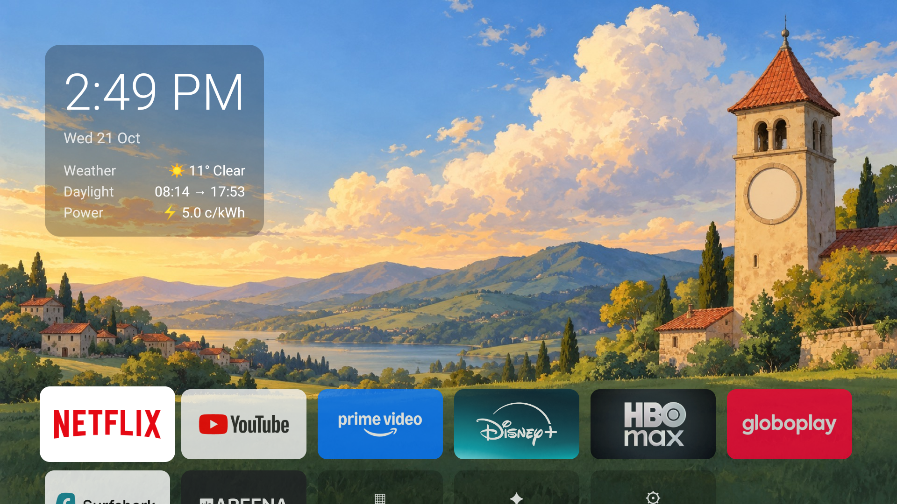
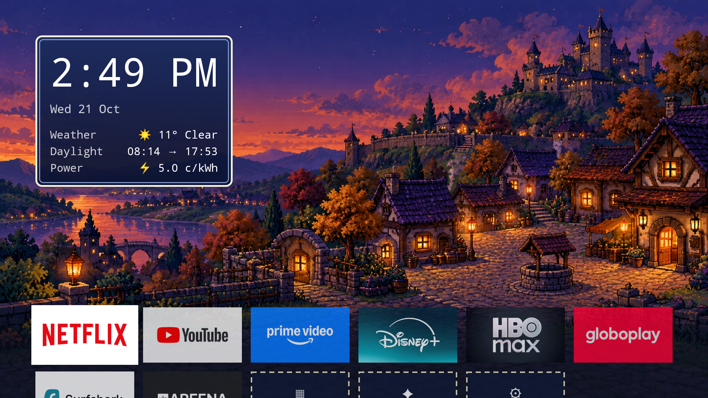

# Lean TV 🪶

A featherweight home screen for Android TV.



Lean TV exists because cheap Android TVs are slow, and the stock launcher is a
big part of why: on a 1.8 GB Xiaomi TV, Google's stock launcher held **~270 MB**
of RAM for sponsored rows and autoplaying recommendations. Lean TV replaces it
with the only things a TV home screen actually needs:

- **One favorites row** — your apps, in your order. No ads, no recommendations,
  no content previews.
- **Clock + weather** — time, date, and current conditions from
  [Open-Meteo](https://open-meteo.com) (free, no API key).
- **All-apps grid** behind a single tile.
- **Settings shortcut** tile (important when the stock launcher is disabled).
- **Static wallpaper**, loaded once as the window background.
- **Ambient mode** — after 10 minutes idle the tiles fade out, the backlight
  dims, and the theme's weather wallpapers rotate slowly; any key wakes it.
  A built-in replacement for the stock screensaver (which holds ~130 MB).

Nothing else. No background services, no telemetry, no network calls except the
weather fetch every 30 minutes while the screen is on.

## Design constraints

Built for weak hardware (tested target: Xiaomi MiTV with a 32-bit quad-core
MediaTek SoC, 1.8 GB RAM, Android TV 10):

- **Kotlin + classic Android Views.** No Compose (runtime overhead), no
  Flutter (ships a ~100 MB engine), no third-party runtime dependencies at all.
- Target idle RSS: **40–70 MB** (stock launcher: ~270 MB; FLauncher: ~199 MB).
  Measured on the target TV: **~52 MB PSS** idle on the home screen —
  wallpapers decode at RGB_565 and the all-apps grid loads lazily and is
  dropped while another app is in front.
- Deliberately out of scope: video/animated wallpapers, recommendation rows,
  content previews, the widgets framework.

## Install

Grab `app-release.apk` from CI artifacts or build it yourself, then:

```bash
adb connect <tv-ip>:5555
adb install -r app-release.apk
adb shell cmd package set-home-activity dev.esmanhoto.leantv/.MainActivity
```

Or use the script: `scripts/install-tv.sh <tv-ip>:5555` — it also AOT-compiles
the launcher and your streaming apps (`cmd package compile -m speed`), which
noticeably speeds up app launches on low-end TV CPUs at the cost of some flash
storage. Edit `AOT_PACKAGES` in the script to match your apps.

Optionally disable the stock launcher afterwards to reclaim its RAM:

```bash
adb shell pm disable-user --user 0 com.google.android.tvlauncher
```

Lean TV's ambient mode replaces the system screensaver, so turn that off too
(otherwise it fires first and ambient never shows). Give the screen-off
timeout enough room for ambient to run before the panel powers down:

```bash
adb shell settings put secure screensaver_enabled 0
adb shell settings put system screen_off_timeout 1800000   # screen off after 30 min
```

### Rescue

If the home screen ever breaks, the stock launcher is one command away
(nothing Lean TV does is destructive):

```bash
adb shell pm enable com.google.android.tvlauncher
adb shell cmd package set-home-activity com.google.android.tvlauncher/.MainActivity
```

## Usage

- **D-pad left/right** moves along the favorites row; **OK** launches.
- **Long-press OK** on any tile: add/remove favorite, app info.
- The **▦ Apps** tile opens the all-apps grid (BACK closes it).
- The **✦ Theme** tile opens the theme picker; **long-press** it to preview
  the weather wallpapers (clear → rain → snow → back to live weather).
- The **⚙ Settings** tile opens Android TV settings.
- **Ambient mode** starts by itself after 10 minutes without a key press on
  the home screen: tiles fade out, the clock stays, the screen dims, and the
  wallpaper crossfades between the theme's weather variants every 3 minutes.
  The first key press only wakes it. Timings are the `AMBIENT_*` constants in
  [`MainActivity.kt`](app/src/main/kotlin/dev/esmanhoto/leantv/MainActivity.kt).

## Configuration

Weather location defaults to Helsinki. Change `weather_latitude` /
`weather_longitude` in `app/src/main/res/values/strings.xml` and rebuild.
Wallpaper: a theme is three 1920×1080 images in
`app/src/main/res/drawable-nodpi/`, named `<prefix>_clear.jpg`,
`<prefix>_rain.jpg`, `<prefix>_snow.jpg`, and the launcher picks one by
current weather. The repo ships two themes: **Meadow** (`wallpaper_*`) and
**Retro RPG** (`retro_*`):

 A third slot, **Shinobi** (`shinobi_*`), is
bring-your-own-images: the theme appears in the picker only if you drop all
three files in before building (ours are anime fan-art, so they stay out of
the repo). Replace any set (same names) to retheme; keep one calm corner for
the clock/widget stack and a calm bottom quarter for the app row.
Default favorites for a fresh install: `Favorites.DEFAULTS` in
[`Favorites.kt`](app/src/main/kotlin/dev/esmanhoto/leantv/Favorites.kt).

## Build

Requires JDK 17+ and the Android SDK (set `sdk.dir` in `local.properties` or
`ANDROID_HOME`).

```bash
./gradlew build          # compile + lint + unit tests
./gradlew :app:assembleDebug
```

## Preview on your computer

No TV needed — run it in the Android TV emulator at 1080p:

```bash
scripts/preview.sh
```

The script installs the Android TV system image on first run (choose the x86
variant inside the script on Intel machines), creates an AVD, boots it, and
launches Lean TV. You get the real UI, navigable with the arrow keys.

## Tests

Pure-logic modules (favorites composition, weather parsing and WMO code
mapping, clock formatting) are plain Kotlin and covered by JVM unit tests —
no emulator required:

```bash
./gradlew test
```

CI runs build + lint + tests on every push and uploads installable APKs.

## Roadmap

- Per-theme weather icons and a bundled pixel font for Retro RPG.
- On-device location/coordinates setting (no rebuild).

## Credits

- Default wallpapers: AI-generated landscape set (clear/rain/snow) made for
  this project.
- Prior art and inspiration: [FLauncher](https://gitlab.com/etienn01/flauncher).

## License

[MIT](LICENSE)
